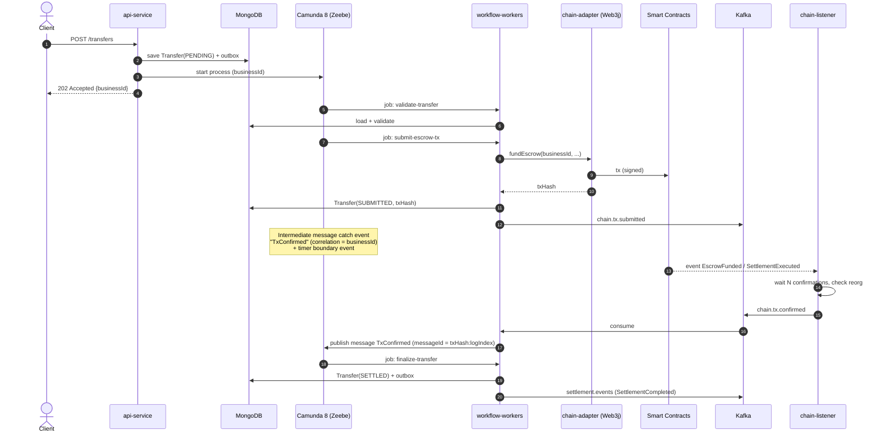
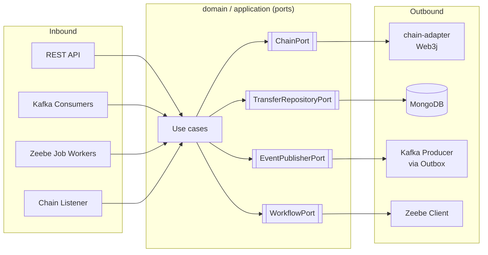

# Chain Settlement Platform

> Blockchain-backed smart-contract orchestration using **Spring Boot 3, Camunda 8 (Zeebe), Kafka, Solidity and Web3j**, documented in **BMAD** style (Brief → PRD → Architecture → Stories → Dev/QA).

| | |
|---|---|
| **Status** | Draft v0.1 |
| **Method** | BMAD (Breakthrough Method for Agile AI-Driven Development) |
| **Domain (reference)** | Tokenized asset transfer with escrowed settlement |
| **Runtime** | Java 21, Spring Boot 3.x |

## Documentation map

- [Project brief](docs/brief/index.md)
- [PRD](docs/prd/index.md)
- [Architecture index](docs/architecture/index.md)
- [Architecture overview](docs/architecture.md)
- [API spec](docs/api-spec.md)
- [Security](docs/security.md)
- [Epics](docs/epics/README.md)
- [Stories](docs/stories/README.md)
- [Architecture decisions](docs/decisions/README.md)
- [Requirement-to-code traceability](docs/traceability.md)

---

## Table of Contents

1. [Project Brief](#1-project-brief)
2. [Assumptions](#2-assumptions)
3. [Requirements (PRD summary)](#3-requirements-prd-summary)
4. [End-to-End Flow](#4-end-to-end-flow)
5. [Technology Stack](#5-technology-stack)
6. [Architecture](#6-architecture)
7. [Smart Contracts](#7-smart-contracts)
8. [BPMN Process & Workers](#8-bpmn-process--workers)
9. [Kafka Topics & Contracts](#9-kafka-topics--contracts)
10. [Project Structure](#10-project-structure)
11. [Getting Started](#11-getting-started)
12. [Testing Strategy](#12-testing-strategy)
13. [Security & Operations](#13-security--operations)
14. [BMAD Workflow, Agents & Backlog](#14-bmad-workflow-agents--backlog)
15. [Definition of Done](#15-definition-of-done)

---

## 1. Project Brief

**Problem.** Parties need a shared, tamper-evident record of ownership and settlement, but business processes (validation, approvals, retries, exceptions, human tasks) are long-running and cannot live inside a smart contract.

**Solution.** Split responsibilities cleanly:

| Concern | Owner |
|---|---|
| Ownership, settlement finality, invariants | **Solidity contracts** (source of truth) |
| Long-running orchestration, timers, human tasks, compensation | **Camunda 8 (Zeebe)** |
| Asynchronous integration & event distribution | **Kafka** |
| Chain I/O (sign, submit, listen, decode) | **Web3j** behind a `chain-adapter` port |
| Domain data, projections, outbox, audit | **MongoDB** |
| APIs, security, glue | **Spring Boot** |

**Success criteria**

- A settlement is never executed twice (idempotent end-to-end).
- Any process instance can be explained from chain tx hash → Kafka event → BPMN history.
- MongoDB projection can be fully rebuilt from chain events.
- Chain outage or reorg never leaves a process in an unrecoverable state.

---

## 2. Assumptions

| # | Assumption | If it changes |
|---|---|---|
| A1 | EVM-compatible chain (Ethereum L2 / Polygon / Besu private network), Solidity contracts, Web3j client | Hyperledger Fabric: swap `chain-adapter` implementation, keep the port interface |
| A2 | Camunda 8 (Zeebe) with external job workers | Camunda 7: use embedded engine and Java delegates; MongoDB still holds domain data only |
| A3 | Camunda keeps its own process-state store (Zeebe + Elasticsearch/OpenSearch). MongoDB is **not** the engine's persistence layer | n/a (Camunda does not support MongoDB as engine DB) |
| A4 | Chain is the source of truth for ownership/settlement; MongoDB is a projection plus workflow data | If chain is only an audit log, relax the reconciliation rules in 6.4 |
| A5 | Java 21, Spring Boot 3.x | Quarkus / Micronaut: adjust modules only |

---

## 3. Requirements (PRD summary)

### Functional

| ID | Requirement |
|---|---|
| FR-1 | Create a transfer request via REST; returns a `businessId` immediately (202). |
| FR-2 | Validate request (schema, entitlement, compliance check) before any chain interaction. |
| FR-3 | Fund escrow and execute settlement on-chain via contract calls. |
| FR-4 | Wait for N block confirmations before marking settlement final. |
| FR-5 | Handle revert, timeout, and reorg with defined compensation paths. |
| FR-6 | Manual approval step for transfers above a configurable threshold (Camunda user task). |
| FR-7 | Publish domain events to Kafka on each state transition. |
| FR-8 | Query transfer status and full audit trail. |
| FR-9 | Rebuild projections from chain history on demand. |

### Non-Functional

| ID | Requirement |
|---|---|
| NFR-1 | At-least-once delivery everywhere; exactly-once **effect** via idempotency keys. |
| NFR-2 | Private keys never in app config or logs; signing via KMS/HSM or Vault. |
| NFR-3 | p95 API response < 300 ms (async acceptance, not settlement). |
| NFR-4 | Horizontal scaling of workers and consumers without duplicate chain submissions. |
| NFR-5 | Full traceability: `businessId` and `txHash` in every log line and event. |

---

## 4. End-to-End Flow

### 4.1 Happy path



### 4.2 Exception paths

| Situation | Detection | Handling |
|---|---|---|
| Validation fails | Worker throws BPMN error `VALIDATION_FAILED` | Error end event → `REJECTED`, event published |
| Approval needed | DMN / gateway on amount | User task; timer escalation after SLA |
| Tx reverted | Receipt `status=0` or `chain.tx.failed` | Compensation subprocess: release escrow if funded, mark `FAILED` |
| No confirmation in time | Timer boundary event | Reconciliation subprocess (see 6.4) |
| Reorg drops tx | Listener sees removed log / depth regress | Emit `chain.tx.reorged`; process rewinds to `SUBMITTED` and resubmits |
| Duplicate request | Unique `businessId` in Mongo and in contract | Return existing transfer; contract reverts with `AlreadyProcessed` |
| Worker crash after submit, before persist | Nonce + `businessId` lookup on chain | On retry, adapter queries chain first → reuses existing tx |

### 4.3 Status model

```
PENDING → VALIDATED → [AWAITING_APPROVAL] → SUBMITTED → CONFIRMING → SETTLED
                  ↘ REJECTED          ↘ FAILED / CANCELLED / RECONCILING
```

---

## 5. Technology Stack

| Layer | Technology | Notes |
|---|---|---|
| Language / Runtime | Java 21, Spring Boot 3.x | Virtual threads enabled for I/O-heavy workers |
| Orchestration | Camunda 8 (Zeebe), Spring Zeebe SDK (`@JobWorker`) | BPMN 2.0 + DMN; Operate/Tasklist for ops |
| Messaging | Apache Kafka, Spring Kafka | Idempotent producer, DLT per topic |
| Blockchain client | Web3j 4.x | Generated Java wrappers from ABI/BIN |
| Smart contracts | Solidity ^0.8.x, OpenZeppelin | Foundry (tests/fuzz) or Hardhat |
| Persistence | MongoDB (domain, projections, outbox) | Camunda has its own store (A3) |
| Process search store | Elasticsearch / OpenSearch | Required by Camunda 8 |
| Build | gradle (multi-module) | `web3j-maven-plugin` for wrapper generation |
| Security | Spring Security (OAuth2/JWT), Vault/KMS | Signing abstraction |
| Observability | Micrometer, OpenTelemetry, Prometheus, Grafana | Trace id = `businessId` baggage |
| Testing | JUnit 5, Testcontainers, Camunda Process Test, Anvil/Besu dev node | |
| CI/CD | GitHub Actions / GitLab CI, Docker, Helm | |

---

## 6. Architecture

### 6.1 Hexagonal layout



Rule: **the domain never imports Web3j, Zeebe, Kafka or Mongo types.** This is what makes A1/A2/A5 swappable.

### 6.2 Components

| Component | Responsibility |
|---|---|
| `api-service` | REST, authN/Z, request validation, starts processes |
| `workflow-workers` | `@JobWorker` handlers; thin: call use cases only |
| `chain-adapter` | Implements `ChainPort`: nonce mgmt, gas, sign, send, receipt, log decoding |
| `chain-listener` | Subscribes to contract events, applies confirmation depth, detects reorgs |
| `projector` | Consumes `chain.events.raw`, updates Mongo projections idempotently |
| `outbox-publisher` | Reads Mongo outbox, publishes to Kafka, marks sent |
| `contracts` | Solidity sources, tests, deployment scripts, ABI/BIN export |

### 6.3 Data ownership

| Data | Store | Authority |
|---|---|---|
| Ownership, escrow balances, settlement state | Chain | **Chain** |
| Process instance state, timers, user tasks | Zeebe + ES/OpenSearch | Camunda |
| Transfer aggregate, audit trail, outbox, processed-event log | MongoDB | Platform (workflow data) |
| Ownership / balance read models | MongoDB | **Projection** of chain |

### 6.4 Reconciliation rules

Applies under A4 (chain is the source of truth).

| # | Rule |
|---|---|
| R1 | If Mongo and chain disagree on ownership/settlement, **chain wins**; Mongo is corrected, never the reverse. |
| R2 | A transfer is `SETTLED` only after the settlement event has ≥ `N` confirmations (configurable per chain). |
| R3 | On timeout, the reconciliation subprocess queries chain by `businessId` (not by stored `txHash` alone): found-and-final → continue; found-not-final → keep waiting; absent → resubmit with same `businessId`. |
| R4 | Reorg: events below the reorg point are marked `orphaned` in the processed-event log; projections are re-applied from the last stable block. |
| R5 | Projection checkpoint `(blockNumber, blockHash)` is stored per contract; mismatch on startup triggers rewind. |
| R6 | A scheduled job compares projection hash vs. on-chain state for a sample of transfers; drift raises an alert and opens a Camunda incident process. |
| R7 | Full rebuild: replay `eth_getLogs` from deployment block into `chain.events.raw` → projector. |

### 6.5 Reliability patterns

- **Transactional outbox** (Mongo multi-document transaction, replica set required): state change + outbox record in one commit; `outbox-publisher` relays to Kafka.
- **Idempotent consumers**: `processed_events` collection keyed by `(txHash, logIndex)` or Kafka `messageId`.
- **Idempotent chain writes**: `businessId` (bytes32) is a contract-level unique key.
- **Zeebe message dedup**: publish messages with `messageId = txHash:logIndex` and a TTL.
- **Nonce management**: single-writer per signer account (partitioned by account key) to avoid nonce gaps.
- **Retries**: job workers use Zeebe retries with backoff; Kafka uses `DefaultErrorHandler` + DLT.

### 6.6 Architecture Decision Records (initial)

| ADR | Decision |
|---|---|
| ADR-001 | Chain is source of truth; Mongo is projection + workflow data |
| ADR-002 | External job workers (not embedded engine) |
| ADR-003 | Hexagonal ports around chain, workflow, messaging |
| ADR-004 | Transactional outbox over dual-write |
| ADR-005 | Confirmation depth + reorg handling in listener, not in contracts |
| ADR-006 | Generated Web3j wrappers committed? **No** — generated at build from `contracts/artifacts` |

---

## 7. Smart Contracts

| Contract | Purpose |
|---|---|
| `AccessRegistry` | Role management (OPERATOR, COMPLIANCE, ADMIN) via OpenZeppelin `AccessControl` |
| `AssetToken` | ERC-721/1155 representation of the asset; transfer restricted to escrow/operator |
| `SettlementEscrow` | Holds asset/funds keyed by `businessId`; executes or cancels settlement |
| `MyToken` | ERC-20 built on OpenZeppelin v5. It has 'owner-only mint()', a hard supply cap, and burning | 
            An optional initial supply is minted to the owner at deployment. |
| `TransferToken` | ERC-20 built on OpenZeppelin v5. It has 'owner-only mint()', a hard supply cap, and burning. The contract is used to transfer ownership of `MyToken` to `SettlementEscrow`.|


**Key design rules**

- Every state-changing function takes `bytes32 businessId`; a mapping rejects reuse (`AlreadyProcessed`).
- Emit rich events (`EscrowFunded`, `SettlementExecuted`, `SettlementCancelled`) with `businessId` **indexed**.
- Pausable; upgrade strategy documented (UUPS proxy or immutable + migration).
- Custom errors instead of revert strings.
- No business logic that needs external data; keep contracts small and auditable.

**Build → Java wrapper pipeline**

```
contracts/src/*.sol ──forge build──▶ out/*.json (ABI + bytecode)
        └──web3j-gradle-plugin / web3j CLI──▶ chain-adapter/target/generated-sources/*.java
```

---

## 8. BPMN Process & Workers

**Process:** `transfer-settlement.bpmn` (key: `transfer-settlement`)

| BPMN element | Type / Job type | Worker behaviour |
|---|---|---|
| Start | Message/None start | Variables: `businessId`, `amount`, `assetId` |
| Validate | Service task `transfer.validate` | Schema + compliance; throws BPMN error on failure |
| Approval gateway | DMN `approval-required` | Threshold rule |
| Manual approval | User task | Candidate group `approvers`; escalation timer |
| Submit escrow | Service task `chain.submit-escrow` | Calls `ChainPort`; idempotent by `businessId` |
| Await confirmation | Message catch `TxConfirmed` + timer boundary (e.g. PT15M) | Correlation key = `businessId` |
| Reconcile | Call activity `reconcile-transfer` | Implements rules R3/R4 |
| Execute settlement | Service task `chain.execute-settlement` | As above |
| Finalize | Service task `transfer.finalize` | Update Mongo, write outbox |
| Compensate | Subprocess / compensation boundary | `chain.cancel-escrow`, `transfer.mark-failed` |

**Worker rules**

1. Workers contain no business logic — they map job variables → use case → result variables.
2. Use `fetchVariables` explicitly; keep process variables small (IDs, not payloads).
3. Distinguish **BPMN errors** (business outcomes) from **technical failures** (retry/incident).
4. Never block a job thread on confirmation waits; use message correlation.

---

## 9. Kafka Topics & Contracts

| Topic | Key | Producer | Consumer(s) | Purpose |
|---|---|---|---|---|
| `chain.events.raw` | `contract:blockNumber` | chain-listener | projector | Decoded raw logs incl. orphan flag |
| `chain.tx.submitted` | `businessId` | workflow-workers (outbox) | monitoring, listener | Tx handed to chain |
| `chain.tx.confirmed` | `businessId` | chain-listener | workflow-workers | Triggers `TxConfirmed` message |
| `chain.tx.failed` | `businessId` | chain-listener | workflow-workers | Triggers compensation |
| `chain.tx.reorged` | `businessId` | chain-listener | workflow-workers | Rewind and resubmit |
| `settlement.events` | `businessId` | outbox-publisher | external consumers | Public domain events |
| `*.dlt` | — | error handler | ops | Dead-letter topics |

**Conventions**

- Envelope: `eventId`, `eventType`, `businessId`, `occurredAt`, `chainId`, `txHash?`, `blockNumber?`, `schemaVersion`, `payload`.
- Schemas in `schemas/` (Avro or JSON Schema) with compatibility checks in CI.
- Partition by `businessId` to preserve per-transfer ordering.

---

## 10. Project Structure
```
smart-contracts-bmad/
├── build-logic/                       # convention plugins
│   └── src/main/kotlin/
│       ├── java-conventions.gradle.kts
│       ├── spring-service-conventions.gradle.kts
│       └── quality-conventions.gradle.kts   # spotless, checkstyle, jacoco
├── gradle/
│   └── libs.versions.toml             # single source of dependency versions
├── settings.gradle.kts
├── build.gradle.kts
├── modules/
│   ├── common-domain/                 # pure Java: value objects, domain events, ports
│   ├── common-observability/          # correlation id, logging, tracing
│   ├── contracts/                     # Solidity sources + generated Web3j wrappers
│   │   ├── src/main/solidity/
│   │   └── build.gradle.kts           # web3j plugin
│   ├── chain-adapter/                 # implements ChainPort via Web3j, tx manager, retry
│   ├── chain-listener/                # event subscription, confirmations, reorg handling
│   ├── persistence-mongo/             # documents, repositories, outbox, idempotency store
│   ├── process-definitions/           # BPMN/DMN/forms + deploy task (no Java logic)
│   │   └── src/main/resources/bpmn/
│   ├── process-workers/               # Zeebe job workers (thin; delegate to domain)
│   ├── domain-service/                # use cases / application layer
│   ├── api-gateway/                   # REST controllers, authN/Z, OpenAPI
│   └── app-bootstrap/                 # Spring Boot main(s), wiring, profiles
├── deployment/
│   ├── docker-compose.yml             # local: zeebe, elastic, mongo(rs), anvil/besu
│   └── helm/
├── docs/
│   ├── prd.md
│   ├── api-spec.md
│   ├── architecture.md
│   ├── architecture-flow.md
│   ├── data-model.md
│   ├── security.md
│   ├── architecture/                  # sharded: tech-stack.md, source-tree.md, coding-standards.md
│   ├── prd/                           # sharded: requirements.md, actors-and-success.md, etc
│   ├── brief/
│   ├── epics/
│   └── stories/
└── .bmad-core/                        # BMAD agents/tasks/templates
```

## 11. Getting Started

### Prerequisites

- JDK 21
- Docker and Docker Compose (for local infrastructure)
- Foundry (`forge`, `anvil`) — or Node + Hardhat
- Web3j CLI (optional, for manual wrapper generation)

The Gradle Wrapper pins Gradle 8.14.5, so a separate Gradle installation is not required.

### Run locally

```bash
# 1. Start the required services (MongoDB, Zeebe, Kafka, and Anvil) using a Compose file.
docker compose -f path/to/docker-compose.yml up -d

# 2. Build and test the Spring Boot project
.\gradlew.bat :modules:contracts:build

# 3. Start the Spring Boot application
.\gradlew.bat :modules:contracts:bootRun
```

The repository does not currently include a Docker Compose file or Solidity deployment scripts. Supply the Compose file for local infrastructure; contract compilation, deployment, and Web3j wrapper generation require the corresponding Solidity sources and scripts.

On macOS or Linux, use `./gradlew` in place of `.\gradlew.bat`.

### Key configuration (`application.yml`)

```yaml
chain:
  rpc-url: ${CHAIN_RPC_URL:http://localhost:8545}
  chain-id: ${CHAIN_ID:31337}
  confirmations: 6
  contracts:
    escrow: ${ESCROW_ADDRESS}
    asset-token: ${ASSET_TOKEN_ADDRESS}
  signer:
    mode: vault            # vault | kms | local-dev-only
    key-ref: ${SIGNER_KEY_REF}

camunda:
  client:
    mode: self-managed
    zeebe:
      grpc-address: http://localhost:26500

spring:
  data.mongodb.uri: mongodb://localhost:27017/settlement?replicaSet=rs0
  kafka:
    bootstrap-servers: localhost:9092
    producer:
      acks: all
      properties.enable.idempotence: true
```

### Try it

```bash
curl -X POST http://localhost:8080/transfers \
  -H 'Content-Type: application/json' \
  -d '{"assetId":"A-1001","from":"0xAAA...","to":"0xBBB...","amount":"1000"}'

curl http://localhost:8080/transfers/{businessId}
```

Open **Camunda Operate** (`http://localhost:8081`) to watch the instance progress.

---

## 12. Testing Strategy

| Level | Scope | Tooling |
|---|---|---|
| Contract unit / fuzz / invariant | Escrow can't double-settle, balances conserved | Foundry |
| Domain unit | Aggregates, state machine | JUnit 5 |
| Adapter integration | Web3j ↔ Anvil: submit, receipt, log decode, nonce | Testcontainers |
| Workflow tests | BPMN paths incl. timers, errors, compensation | Camunda Process Test |
| Messaging | Idempotent consumers, DLT, ordering | Testcontainers Kafka |
| Reorg / chaos | Anvil snapshot/revert, kill worker mid-submit | Custom e2e |
| Architecture | Dependency rules | ArchUnit |
| End-to-end | REST → chain → Kafka → Mongo | Cucumber |

---

## 13. Security & Operations

- **Keys:** never stored in repo/env in production; signing through Vault Transit / cloud KMS / HSM behind `SignerPort`.
- **Contract access:** role-based; operator keys minimal-privilege; pausable circuit breaker.
- **API:** OAuth2/JWT, scopes per endpoint, request size limits, rate limiting.
- **Audit:** immutable audit collection; every state transition records actor, `businessId`, `txHash`.
- **PII:** keep off-chain; put only hashes/identifiers on-chain.
- **Metrics:** tx submit latency, confirmation lag, reorg count, outbox backlog, DLT depth, projection drift, Zeebe incidents.
- **Alerts:** stuck `CONFIRMING` > SLA, nonce gap, signer balance low, drift detected (R6).
- **Runbooks:** `docs/runbooks/` — stuck tx (speed-up/cancel), rebuild projection, replay DLT, rotate signer.

---

## 14. BMAD Workflow, Agents & Backlog

### 14.1 Agent roles → artifacts

| BMAD agent | Output in this repo |
|---|---|
| Analyst | `docs/brief.md` |
| PM | `docs/prd.md` (FR/NFR above), epics |
| Architect | `docs/architecture.md`, ADRs, this README's section 6 |
| PO | Validated, sharded epics and stories (`docs/epics`, `docs/stories`) |
| Scrum Master | Story files with full implementation context |
| Dev | Code + tests per story |
| QA | Review notes, test design, risk profile per story |

### 14.2 Epics0

| Epic | Theme | Highlights |
|---|---|---|
| E1 | Foundation | Repo, parent POM, docker-compose, CI, ArchUnit rules |
| E2 | Smart contracts | Access, token, escrow, tests, deploy scripts |
| E3 | Chain adapter | Web3j wrappers, signer port, nonce manager, receipts |
| E4 | Workflow | BPMN, DMN, job workers, error/compensation paths |
| E5 | Messaging & persistence | Outbox, Kafka topics, idempotent consumers |
| E6 | Chain listener & projector | Confirmations, reorgs, checkpoints, rebuild |
| E7 | API & security | REST, OAuth2, OpenAPI, audit |
| E8 | Reconciliation & ops | Rules R1–R7, drift job, dashboards, runbooks |

### 14.3 Example story (SM format)

```markdown
# Story 3.2: Submit escrow transaction idempotently

## Status
Ready for Dev

## Story
As a workflow worker, I want to submit `fundEscrow` once per businessId,
so that retries never create duplicate on-chain effects.

## Acceptance Criteria
1. Before sending, adapter queries chain by businessId; if found, returns existing txHash.
2. Nonce assigned by single-writer per signer account.
3. Reverted tx results in `ChainTxFailedException` mapped to BPMN error.
4. Integration test against Anvil covers retry-after-crash.

## Tasks
- [ ] Add `findByBusinessId` to ChainPort
- [ ] Implement in Web3jChainAdapter
- [ ] Nonce manager with Mongo-backed lock
- [ ] Tests (unit + Testcontainers/Anvil)

## Dev Notes
See architecture §6.4 (R3), §6.5 (idempotent chain writes).
```

---

## 15. Definition of Done

- [ ] Acceptance criteria met and demonstrated
- [ ] Unit + integration tests green; contract tests include negative and fuzz cases
- [ ] BPMN paths covered by workflow tests
- [ ] No domain-layer dependency violations (ArchUnit)
- [ ] Events versioned and schema-checked
- [ ] Logs/metrics/traces carry `businessId` (and `txHash` where applicable)
- [ ] Security review for any signer, role, or contract-permission change
- [ ] ADR added/updated for architectural decisions
- [ ] Docs and runbooks updated

---

## License

This repository is private and has no open-source license. No license is granted
to copy, modify, distribute, or reuse this project. Contact the maintainers for
permission.

## Development workflow

Use GitHub Flow with `master` as the integration branch:

1. Create a short-lived `feature/<description>` or `fix/<description>` branch from `master`.
2. Open a pull request targeting `master`; run the relevant checks and request review before merging.
3. Do not commit directly to `master`.
