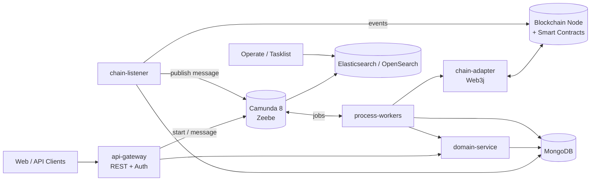
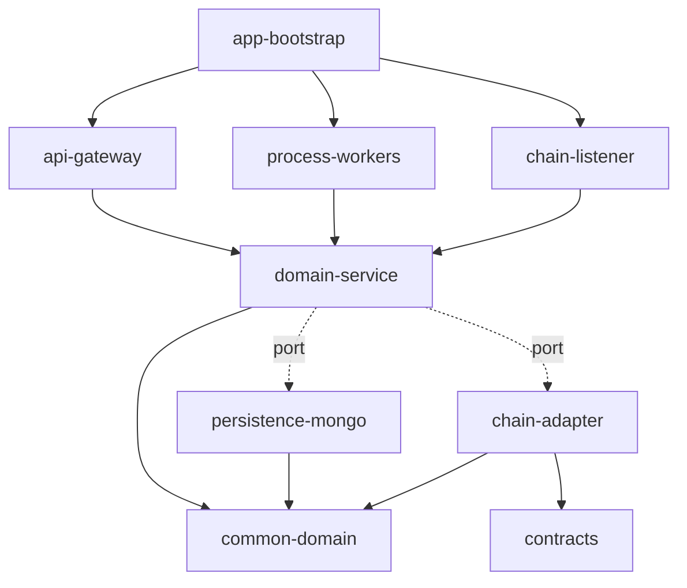
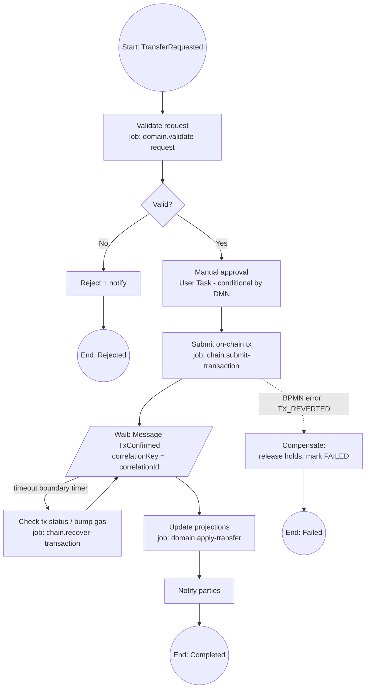

# Blockchain Platform Architecture Document

> BMAD artifact: `docs/architecture.md` (Architect agent output)
> Stack: Java + Gradle (multi-module) · Camunda 8 (Zeebe) · MongoDB · EVM-compatible blockchain
> Status: Draft v0.1 · Versions are placeholders; pin and verify them in `gradle/libs.versions.toml`

---

## 1. Introduction

### 1.1 Purpose
This document defines the technical architecture for a blockchain-backed business platform in which **Camunda orchestrates long-running business processes**, **MongoDB stores off-chain domain state and read models**, and **the blockchain is the tamper-evident system of record** for critical state transitions.

### 1.2 Assumptions (change these early; they drive everything)
| # | Assumption | Alternative if wrong |
|---|-----------|----------------------|
| A1 | EVM-compatible chain (Ethereum L2 / Polygon / Besu private network), Solidity contracts, Web3j client | Hyperledger Fabric: swap `chain-adapter` implementation, keep the port interface |
| A2 | Camunda 8 (Zeebe) with external job workers | Camunda 7: use embedded engine and Java delegates; MongoDB still holds domain data only |
| A3 | Camunda keeps its own process-state store (Zeebe + Elasticsearch/OpenSearch). MongoDB is **not** the engine's persistence layer | n/a (Camunda does not support MongoDB as engine DB) |
| A4 | Chain is the source of truth for ownership/settlement; MongoDB is a projection plus workflow data | If chain is only an audit log, relax the reconciliation rules in 6.4 |
| A5 | Java 21, Spring Boot 3.x | Quarkus / Micronaut: adjust modules only |

### 1.3 Architectural drivers
- **Integrity:** every business-critical state change is anchored on-chain.
- **Auditability:** process history (Camunda) + on-chain events + Mongo audit trail correlate via one `correlationId`.
- **Resilience to chain latency:** transactions are asynchronous with confirmation depth; processes wait, never block threads.
- **Idempotency:** workers and listeners are safe to retry.
- **Modularity:** Gradle modules enforce dependency direction (hexagonal).

---

## 2. High-Level Architecture



### 2.1 Architectural style
- **Hexagonal (ports and adapters)** inside each service; **event-driven orchestration** across services.
- **Orchestration (Camunda) over choreography** for the business process; choreography only for chain-event ingestion.
- **Transactional outbox** between MongoDB writes and external side effects (chain tx submission, Zeebe messages).

### 2.2 Responsibility split
| Concern | Owner |
|---|---|
| Process flow, timers, human tasks, compensation | Camunda (BPMN/DMN) |
| Business entities, read models, audit, idempotency keys | MongoDB |
| Ownership, settlement, immutable proofs, rules enforced trustlessly | Smart contracts |
| Key custody & signing | Signer service / HSM / KMS (never in workers' memory long-term) |

---

## 3. Technology Stack (BMAD `tech-stack.md` shard)

| Layer | Choice | Notes |
|---|---|---|
| Language/Runtime | Java 21 | Virtual threads optional for IO-bound workers |
| Framework | Spring Boot 3.x | |
| Build | Gradle 8.x, Kotlin DSL, version catalog, convention plugins | |
| Orchestration | Camunda 8 (Zeebe) + Spring Zeebe SDK | Verify current client artifact for your Camunda version |
| Persistence | MongoDB 7.x (replica set required for transactions) | Spring Data MongoDB |
| Blockchain client | Web3j (+ Gradle web3j plugin for contract wrappers) | |
| Contracts | Solidity + Foundry or Hardhat | Compiled ABI/bytecode consumed by Gradle |
| Messaging (optional) | Kafka | Only if fan-out beyond Zeebe is needed |
| Observability | OpenTelemetry, Micrometer, Prometheus, Grafana, Loki | |
| Testing | JUnit 5, Testcontainers (Mongo, Zeebe, Anvil/Besu), Camunda Process Test | |
| Packaging/Deploy | Docker, Helm, Kubernetes | |
| Secrets/Keys | Vault / cloud KMS / HSM | |

---

## 4. Repository and Gradle Structure (BMAD `source-tree.md` shard)

```
blockchain-platform/
├── build-logic/                       # convention plugins
│   └── src/main/kotlin/
│       ├── java-conventions.gradle.kts
│       ├── spring-service-conventions.gradle.kts
│       └── quality-conventions.gradle.kts   # spotless, checkstyle, jacoco
├── gradle/
│   └── libs.versions.toml             # single source of dependency versions
├── settings.gradle.kts
├── build.gradle.kts
├── modules/
│   ├── common-domain/                 # pure Java: value objects, domain events, ports
│   ├── common-observability/          # correlation id, logging, tracing
│   ├── contracts/                     # Solidity sources + generated Web3j wrappers
│   │   ├── src/main/solidity/
│   │   └── build.gradle.kts           # web3j plugin
│   ├── chain-adapter/                 # implements ChainPort via Web3j, tx manager, retry
│   ├── chain-listener/                # event subscription, confirmations, reorg handling
│   ├── persistence-mongo/             # documents, repositories, outbox, idempotency store
│   ├── process-definitions/           # BPMN/DMN/forms + deploy task (no Java logic)
│   │   └── src/main/resources/bpmn/
│   ├── process-workers/               # Zeebe job workers (thin; delegate to domain)
│   ├── domain-service/                # use cases / application layer
│   ├── api-gateway/                   # REST controllers, authN/Z, OpenAPI
│   └── app-bootstrap/                 # Spring Boot main(s), wiring, profiles
├── deploy/
│   ├── docker-compose.yml             # local: zeebe, elastic, mongo(rs), anvil/besu
│   └── helm/
├── docs/
│   ├── prd.md
│   ├── architecture.md
│   ├── architecture/                  # sharded: tech-stack.md, source-tree.md, coding-standards.md
│   ├── epics/
│   └── stories/
└── .bmad-core/                        # BMAD agents/tasks/templates
```

### 4.1 Module dependency rules (enforced with ArchUnit or Gradle `dependencies` review)



Rules:
1. `common-domain` has **no** framework, Mongo, Web3j, or Camunda imports.
2. `process-workers` contain no business logic: map job variables → use case call → complete/fail/throw BPMN error.
3. `chain-adapter` and `persistence-mongo` implement ports defined in `common-domain`.
4. No module depends on `app-bootstrap`.

### 4.2 Gradle snippets

`settings.gradle.kts`
```kotlin
pluginManagement { includeBuild("build-logic") }
dependencyResolutionManagement { repositories { mavenCentral() } }
rootProject.name = "blockchain-platform"
include(
  "modules:common-domain", "modules:common-observability", "modules:contracts",
  "modules:chain-adapter", "modules:chain-listener", "modules:persistence-mongo",
  "modules:process-definitions", "modules:process-workers",
  "modules:domain-service", "modules:api-gateway", "modules:app-bootstrap"
)
```

`gradle/libs.versions.toml` (versions are placeholders)
```toml
[versions]
spring-boot = "3.x.x"
web3j = "x.y.z"
zeebe = "8.x.x"
testcontainers = "x.y.z"

[libraries]
spring-boot-starter-web   = { module = "org.springframework.boot:spring-boot-starter-web" }
spring-boot-starter-mongo = { module = "org.springframework.boot:spring-boot-starter-data-mongodb" }
web3j-core                = { module = "org.web3j:core", version.ref = "web3j" }
# Camunda 8 Spring SDK: confirm artifact for your target version
testcontainers-mongodb    = { module = "org.testcontainers:mongodb", version.ref = "testcontainers" }

[plugins]
spring-boot = { id = "org.springframework.boot", version.ref = "spring-boot" }
web3j       = { id = "org.web3j", version = "x.y.z" }
```

`modules/contracts/build.gradle.kts`
```kotlin
plugins { id("java-conventions"); alias(libs.plugins.web3j) }
web3j {
    generatedPackageName = "com.acme.platform.contracts.generated"
    generatedFilesBaseDir = layout.buildDirectory.dir("generated/web3j").get().asFile.path
}
```

`modules/process-definitions/build.gradle.kts`: a custom `deployBpmn` task (or CI step using `zbctl`/REST) that deploys everything in `src/main/resources/bpmn`. Version BPMN files and treat them as code.

---

## 5. Domain and Data Architecture (MongoDB)

### 5.1 Principles
- One aggregate per document; embed what is read together, reference otherwise.
- Every document carries `_id`, `version` (optimistic locking), `createdAt`, `updatedAt`, and `correlationId`.
- No sensitive plaintext or private keys in MongoDB. Store references (key aliases) only.
- Use **multi-document transactions** only inside one service boundary and only when the outbox pattern needs it.

### 5.2 Core collections (illustrative: replace with your domain)

| Collection | Purpose | Key fields | Indexes |
|---|---|---|---|
| `assets` | Off-chain asset/business entity projection | `assetId`, `ownerRef`, `status`, `onChain{contract, tokenId, lastTx}` | `assetId` unique; `ownerRef`; `status` |
| `transactions` | Business transaction records | `txnId`, `processInstanceKey`, `state`, `chainTxHash`, `attempts[]` | `txnId` unique; `chainTxHash`; `state` |
| `chain_events` | Raw ingested events (append-only) | `chainId`, `blockNumber`, `txHash`, `logIndex`, `eventName`, `payload`, `confirmations` | compound unique `(chainId, txHash, logIndex)` |
| `outbox` | Transactional outbox | `type` (`SUBMIT_TX`/`ZEEBE_MESSAGE`), `payload`, `status`, `nextAttemptAt` | `(status, nextAttemptAt)` |
| `idempotency_keys` | Dedup for workers/API | `key`, `result`, `expiresAt` | `key` unique; TTL on `expiresAt` |
| `audit_log` | Business audit trail | `actor`, `action`, `entityRef`, `correlationId`, `ts` | `entityRef`; `correlationId` |
| `listener_checkpoints` | Chain-listener progress | `chainId`, `lastProcessedBlock`, `lastBlockHash` | `chainId` unique |

### 5.3 Example document (`transactions`)
```json
{
  "_id": "txn_01HX...",
  "version": 3,
  "correlationId": "c0a8-...",
  "processInstanceKey": 2251799813685249,
  "state": "AWAITING_CONFIRMATION",
  "chainTxHash": "0xabc...",
  "attempts": [{ "n": 1, "submittedAt": "2026-10-01T12:00:00Z", "gasPrice": "..." }],
  "createdAt": "...", "updatedAt": "..."
}
```

### 5.4 Deployment notes
- Replica set (minimum 3 nodes) in non-dev environments, required for transactions and change streams.
- Write concern `majority`, read concern `majority` for financial state; secondary reads only for non-critical dashboards.
- Encrypt at rest and in transit; field-level encryption for PII.

---

## 6. Blockchain Architecture

### 6.1 Smart contracts
- Keep contracts **small and purpose-built**: ownership/registry, state-transition guard, event emission. Business logic with frequent change stays off-chain.
- Upgradeability: proxy pattern (UUPS/Transparent) with role-based access (`AccessControl`) and timelock for upgrades.
- Emit **rich events**; the platform reads state transitions from events, not by polling storage.
- Include `correlationId` (bytes32) in relevant calls and events so chain activity joins to process instances.

### 6.2 `ChainPort` (defined in `common-domain`)
```java
public interface ChainPort {
    TxSubmission submit(ChainCommand command, IdempotencyKey key); // returns txHash, nonce
    TxStatus status(String txHash);                                // PENDING | CONFIRMED(n) | FAILED | REPLACED
    Optional<OnChainState> read(AssetRef ref);
}
```
Implemented by `chain-adapter` using Web3j. Responsibilities: nonce management (single-writer per signing account), gas estimation and bumping, retry with replacement transactions, and signer abstraction.

### 6.3 Chain listener
- Subscribes (WebSocket) with HTTP backfill from `listener_checkpoints`.
- Stores raw events in `chain_events` (unique key makes ingestion idempotent).
- **Confirmation depth:** event is `PENDING` until N confirmations; only then publishes a Zeebe message (`TxConfirmed`) correlated by `correlationId`.
- **Reorg handling:** track `blockHash`; if hash mismatch at a prior block, roll back affected `chain_events`, mark dependent projections `REORGED`, and emit a compensation message.

### 6.4 Consistency and reconciliation
- Chain wins for ownership/settlement fields; MongoDB projections are rebuildable from `chain_events`.
- Scheduled reconciliation job compares `assets.onChain` to on-chain state and raises incidents on drift.
- Never mark a business step "complete" on tx submission, only on confirmed event.

### 6.5 Key management
- Signing via KMS/HSM-backed signer (e.g., remote signer service). Workers request signatures; they never hold raw private keys.
- Separate keys per environment and per role (operator, deployer, upgrader).

---

## 7. Process Orchestration Architecture (Camunda)

### 7.1 Conventions
- BPMN files in `process-definitions`, named `<domain>-<process>.bpmn`, process IDs kebab-case.
- **Job types** namespaced: `chain.submit-transaction`, `domain.validate-request`, `notify.send`.
- Process variables hold **IDs and small state only**; large/PII payloads stay in MongoDB, referenced by ID.
- Every instance starts with a `correlationId` variable.

### 7.2 Reference process: *Asset Transfer*



### 7.3 Worker contract
1. Receive job → read `correlationId` and IDs.
2. Check `idempotency_keys` (key = `jobKey` or `correlationId:step`). If present, return the stored result.
3. Call the use case in `domain-service`.
4. `complete` with minimal variables; on **technical** failure `fail` with retries and backoff; on **business** failure throw a **BPMN error** with a defined code.
5. Never block waiting for chain confirmation. The process waits on a message event.

### 7.4 Rules and decisions
- Approval thresholds, routing, and compliance flags live in **DMN tables** (versioned alongside BPMN), not hard-coded.

### 7.5 Message correlation
`chain-listener` publishes `TxConfirmed` with `correlationKey = correlationId` and a TTL long enough to cover the race where the message arrives before the process reaches the catch event.

### 7.6 Operations
- Operate for incident handling; alert on incident count and job-activation latency.
- Process versioning: migrate long-running instances deliberately, and never delete BPMN versions with active instances.

---

## 8. Cross-Cutting Patterns

### 8.1 Transactional outbox
```
API/worker ─► [Mongo txn: update entity + insert outbox row] ─► outbox relay ─► (submit tx | publish Zeebe msg)
```
The relay polls `outbox` (or uses change streams), executes the side effect, and marks the row `DONE`. At-least-once delivery plus idempotent consumers gives effectively-once behavior.

### 8.2 Idempotency
- API: `Idempotency-Key` header persisted in `idempotency_keys`.
- Workers: keyed by job key / step key.
- Chain: contract functions accept a unique request ID; duplicates revert or no-op.

### 8.3 Correlation and tracing
One `correlationId` flows: HTTP header → Zeebe variable → Mongo documents → contract call/event → logs/traces (OpenTelemetry baggage).

### 8.4 Error taxonomy
| Class | Example | Handling |
|---|---|---|
| Technical transient | Node timeout, Mongo failover | Retry with backoff |
| Technical permanent | Bad ABI, config error | Incident, alert |
| Business | Insufficient balance, validation | BPMN error → compensation path |
| Chain | Revert, dropped/replaced tx, reorg | Recovery subprocess / compensation |

---

## 9. Security Architecture

- **AuthN/Z:** OIDC (Keycloak/Entra/Auth0), JWT at the gateway, role- and attribute-based checks in the use-case layer. Camunda components behind SSO with least-privilege roles.
- **Network:** private subnets for Mongo, Zeebe, and chain nodes; mTLS between services; node RPC not publicly exposed.
- **Secrets:** Vault/KMS; no secrets in Gradle files, images, or BPMN.
- **Smart contract security:** audits, static analysis (Slither), fuzzing (Foundry), pause/circuit-breaker role, timelocked upgrades.
- **Data protection:** PII off-chain only (chain stores hashes/commitments), field-level encryption, retention policies; consider GDPR/PIPEDA implications of immutable data.
- **Supply chain:** Gradle dependency locking, SBOM generation, vulnerability scanning in CI.

---

## 10. Testing Strategy (BMAD `coding-standards.md` shard)

| Level | Scope | Tools |
|---|---|---|
| Unit | Domain logic, mappers | JUnit 5, AssertJ |
| Contract | Solidity behavior | Foundry/Hardhat tests, fuzz/invariants |
| Component | Mongo repositories, outbox, idempotency | Testcontainers (MongoDB replica set) |
| Process | BPMN paths, DMN, timers, error flows | Camunda Process Test (embedded/Testcontainers) |
| Integration | Worker ↔ chain-adapter ↔ local chain | Testcontainers + Anvil/Besu |
| E2E | API → process → chain → projection | docker-compose env, Karate/RestAssured |
| Non-functional | Throughput, confirmation latency, failure injection | Gatling/k6, Toxiproxy |

Coding standards: constructor injection only, no business logic in controllers/workers, records for immutable DTOs, ArchUnit tests enforcing module rules, Spotless + Checkstyle in `check`, 80% line coverage on `common-domain` and `domain-service`.

---

## 11. Infrastructure and Deployment

### 11.1 Environments
`local` (docker-compose) → `dev` → `test` → `prod`; testnet or private chain for non-prod, mainnet/consortium chain for prod.

### 11.2 Local `docker-compose` services
Zeebe (+ Operate/Tasklist), Elasticsearch/OpenSearch, MongoDB (single-node replica set), Anvil or Besu, optional Kafka, Prometheus/Grafana.

### 11.3 Kubernetes topology
- `app` deployment(s): api, workers, listener (scale independently; **listener runs as single active instance** with leader election).
- Stateful: Mongo (operator or managed Atlas/DocumentDB-compatible alternative with transaction support), Zeebe brokers, Elasticsearch.
- Chain node: managed provider (Alchemy/Infura-class) or self-hosted with redundancy.

### 11.4 CI/CD
1. `./gradlew check` (unit, ArchUnit, quality)
2. Contract tests + static analysis
3. Integration/process tests (Testcontainers)
4. Build images, SBOM, scan
5. Deploy BPMN/DMN (versioned) → deploy app → smoke tests
6. Contract deployments are **manual-gated** with multisig approval

---

## 12. Non-Functional Requirements

| NFR | Target (set with stakeholders) | Design response |
|---|---|---|
| Availability | 99.9% API | Stateless services, HA Mongo/Zeebe, multiple RPC providers |
| Latency (API) | p95 < 300 ms | Async chain interaction, read from Mongo projections |
| Finality | Per chain (e.g., N confirmations) | Message-wait pattern, configurable depth |
| Throughput | TBD TPS | Worker horizontal scaling, nonce-safe signer queue |
| Auditability | Full lineage per transaction | `correlationId`, append-only `chain_events`, `audit_log` |
| Recoverability | RPO ≤ 5 min, RTO ≤ 1 h | Mongo PITR, Zeebe snapshots, replay from `chain_events` |

---

## 13. Risks and Open Decisions

| ID | Item | Impact | Next step |
|---|---|---|---|
| R1 | Public vs private/consortium chain | Cost, privacy, finality | Decide in PRD |
| R2 | Camunda 8 SaaS vs self-managed | Ops load, data residency | Platform review |
| R3 | Throughput of single signing account (nonce) | Bottleneck | Signer pool / account sharding |
| R4 | Reorg / finality risk on chosen chain | Incorrect completion | Tune confirmation depth |
| R5 | Immutable data vs privacy law | Compliance | Hash-only on-chain policy |
| R6 | Contract upgrade governance | Security | Define multisig + timelock |

---

## 14. BMAD Handoff

### 14.1 Suggested epics (for PO sharding)
1. **E1 Platform foundation:** Gradle multi-module scaffold, conventions, CI, docker-compose environment
2. **E2 Persistence core:** Mongo documents, outbox, idempotency, audit
3. **E3 Contracts & chain adapter:** contracts, Web3j wrappers, `ChainPort`, signer integration
4. **E4 Chain listener:** ingestion, confirmations, reorg handling, checkpointing
5. **E5 Process orchestration:** BPMN/DMN, workers, message correlation, recovery subprocess
6. **E6 API & security:** gateway, OIDC, OpenAPI, idempotency header
7. **E7 Observability & ops:** tracing, metrics, dashboards, alerts, runbooks
8. **E8 Hardening:** load, chaos, security review, reconciliation job

### 14.2 Story-readiness checklist for the Scrum Master / Dev agents
- Story references the sharded docs: `tech-stack.md`, `source-tree.md`, `coding-standards.md`.
- Names the target Gradle module(s) and respects dependency rules (4.1).
- Lists BPMN job types / message names / collections touched.
- States idempotency and failure behavior explicitly.
- Defines test level(s) from section 10.

### 14.3 Recommended shard files
```
docs/architecture/
  tech-stack.md          # section 3
  source-tree.md         # section 4
  coding-standards.md    # section 10 + 8
  data-models.md         # section 5
  blockchain.md          # section 6
  process-design.md      # section 7
  security.md            # section 9
  infrastructure.md      # section 11
```

---

## 15. Change Log
| Date | Version | Description | Author |
|---|---|---|---|
| 2026-10-01 | 0.1 | Initial draft | Architect |
